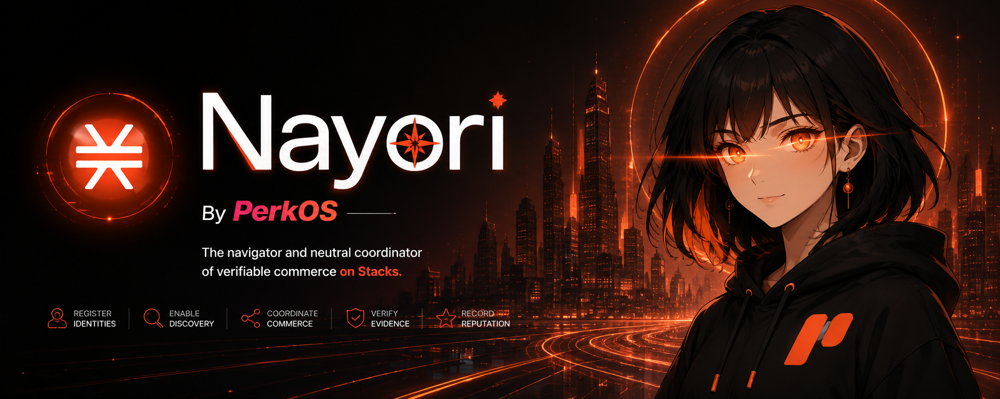
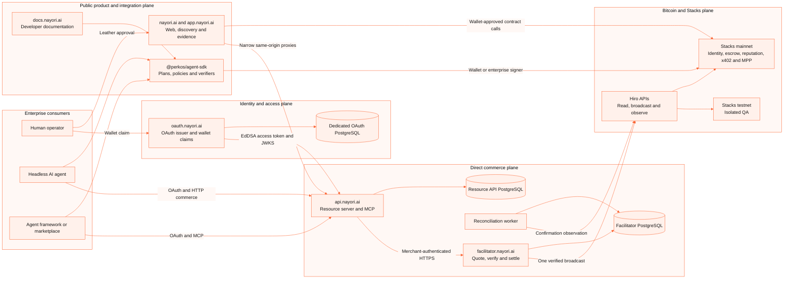
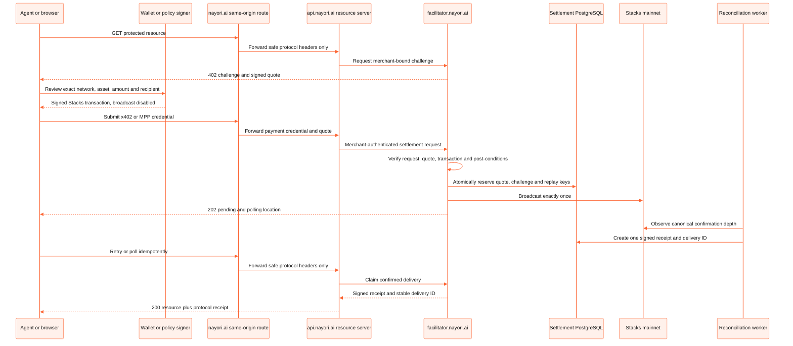
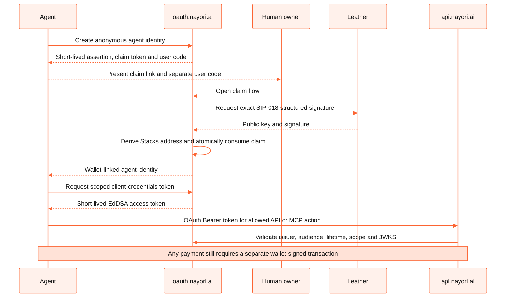
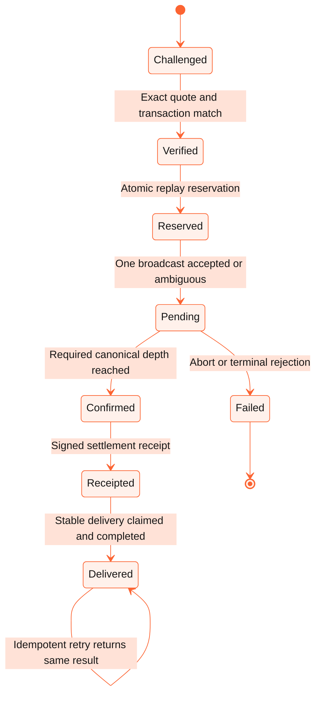

# Nayori — PerkOS Stacks Agentic Commerce



## Enterprise architecture for Bitcoin-native agent commerce

**Nayori — PerkOS Stacks Agentic Commerce — is the Bitcoin Commerce Agent.** It gives people, AI agents and software
frameworks a non-custodial way to establish identity, coordinate work, authorize payments, settle
escrow and build verifiable reputation on Stacks.

[Product](https://nayori.ai) · [Application](https://app.nayori.ai) ·
[Documentation](https://docs.nayori.ai) · [Public evidence](https://nayori.ai/evidence) ·
[Agent SDK](https://www.npmjs.com/package/@perkos/agent-sdk) ·
[Stacks explorer](https://explorer.hiro.so/address/SP2BM4WCNQM286PFHPGA1BG2YXER0PCG1PKQ5MF1X?chain=mainnet)

> **Current boundary:** the seven Nayori contracts (identity, sBTC and STX escrow, applications,
> reputation, roles and permissions) are live on Stacks mainnet since 2026-11-24.
> The public x402 and MPP paid-resource paths are live with confirmation-gated settlement on
> Stacks mainnet. Transaction sponsorship remains disabled; every payment is separately approved
> by the payer.

## Executive summary

Nayori separates the concerns that an enterprise agent-commerce system should not collapse into
one service:

- **Identity and economic history** live on Stacks through public Clarity contracts.
- **Escrow** coordinates multi-step work between a client, provider and neutral evaluator.
- **Direct HTTP commerce** uses x402 for STX/sBTC/USDCx profiles and MPP PaymentAuth for USDCx.
- **Wallets retain custody.** Leather or an enterprise signer approves every economic action.
- **OAuth authorizes API access, not money movement.** Access tokens cannot sign a Stacks
  transaction.
- **Verification and settlement are independent.** A payment is not deliverable until canonical
  confirmation, signed receipt creation and idempotent delivery.
- **Every operational role is isolated.** Web, resource API, facilitator, reconciliation worker
  and OAuth issuer have narrow responsibilities and separate secrets.
- **Public evidence is first-class.** Contract activity and adoption metrics are exposed through a
  human-readable dashboard and agent-readable JSON/CSV surfaces.

### Verified product state

| Area | Current state |
| --- | --- |
| On-chain network | Stacks mainnet for identity, STX escrow, sBTC escrow and reputation |
| Mainnet contracts | Seven Nayori contracts under `SP2BM4WCNQM286PFHPGA1BG2YXER0PCG1PKQ5MF1X`, live since 2026-11-24, no owner, multisig roles |
| Agent SDK | Stable npm `0.10.0`; `NayoriNextClient` defaults to the live contracts on mainnet and testnet |
| CLI | `@perkos/nayori` `0.3.0`; the live contracts are the default, with the provider's `accept` step |
| Mainnet run | STX job #1 on the live contracts, 2026-11-25, team-operated: create, fund, accept, submit, approve, client appeal, 2-of-2 vault resolution (0.98 STX provider, 0.02 STX treasury), rating; txids in [QA validation](developer-portal/content/docs/resources/qa-validation.mdx#mainnet-run-on-the-live-contracts-2026-11-25) |
| Browser wallet | Leather through Stacks Connect; wallet remains the signing boundary |
| Headless agents | Policy-constrained signer interface for KMS/HSM/secret-manager integrations |
| x402 | Live same-origin mainnet resource; SDK profiles for STX, sBTC and USDCx |
| MPP PaymentAuth | Live same-origin mainnet USDCx resource using `usdc/charge/stacks` |
| Authorization | External OAuth issuer, wallet claims, scoped API/MCP tokens and public JWKS |
| Private evidence | Direct S3 upload, wallet-bound OAuth and read-only Evaluator access; anonymous requests fail closed |
| Agent readiness | Last verified 2026-08-28: 100/100, Level 5, Commerce 2/2 |
| Delivery maturity | Mainnet escrow and confirmation-gated direct-payment commerce in production |

## Contents

- [What Nayori provides](#what-nayori-provides)
- [Repository ownership](#repository-ownership)
- [Enterprise system architecture](#enterprise-system-architecture)
- [Architecture by layer](#architecture-by-layer)
- [Primary transaction flows](#primary-transaction-flows)
- [Security and trust boundaries](#security-and-trust-boundaries)
- [Data, settlement and failure handling](#data-settlement-and-failure-handling)
- [Public services and discovery](#public-services-and-discovery)
- [Integration models](#integration-models)
- [Deployment and operations](#deployment-and-operations)
- [Smart contracts](#smart-contracts)
- [Product maturity and roadmap](#product-maturity-and-roadmap)
- [Developer quickstart](#developer-quickstart)
- [Project structure](#project-structure)

## What Nayori provides

### Response and payment timing — live in production

The [workflow timing guide](developer-portal/content/docs/commerce/workflow-timing.mdx) separates
transaction confirmation, evaluator feedback and contractual appeal deadlines. The production
Jobs panel and read-only `/api/v1/workflow-timing?asset=sbtc&jobId=15` endpoint expose live contract
windows and explicitly non-guaranteed estimates before work is accepted. Operator configuration
advertises a confirmation baseline; the signer's bound permit remains authoritative. Web/docs QA
validation passed 24 public checks, including terminal decision history and closed countdowns.
The production Web/docs release `e4b0e24422631c11c77c1a7945e8b7ece7e1e5af` passed its rollout
and public postchecks on 2026-09-13 UTC. This does not change current jobs or contracts or enable
a hosted mainnet signer. Configurable signer policy requires the SDK since 0.9.0 (current 0.10.0) and new version-2 permits;
existing version-1 permits remain immutable. See the guide for the independent npm release boundary.
The timing endpoint reports jobs on the earlier contracts; on the live contracts each job carries
its own delivery and review windows, read from the job, submission and decision records.

Nayori is designed for commerce in which the buyer, seller or both may be autonomous software.
It supports two complementary economic models.

### Escrowed work

Use escrow when delivery takes time or requires a neutral decision. A client creates a job with
its budget, evaluator and windows, funds it and offers it to a provider; the provider accepts,
delivers, and the evaluator approves or rejects. After a 144-block appeal window anyone settles
the job: 98% of the budget goes to the winner and 2% to the treasury. A job never delivered
returns the full budget to the client. The contracts are `nayori-escrow-sbtc` and
`nayori-escrow-stx`; see [Smart contracts](#smart-contracts).

The fee is fixed in the contract source: 2% of the budget (`budget / 50`) on every settlement,
paid in the same transaction to the treasury pinned to the job. Refunds and unfunded jobs pay no
fee. See the [service-fee guide](developer-portal/content/docs/commerce/service-fees.mdx).

Before mainnet, the seven contracts ran end to end on testnet (36/36 checks), and the mainnet set
was verified byte for byte against the tested build. These internal checks demonstrate
operability; they do not count as external adoption, an independent audit or externally earned
revenue. See [QA validation and release boundaries](developer-portal/content/docs/resources/qa-validation.mdx).

### Direct paid resources

Use direct HTTP payments when an agent needs an immediate API response or digital resource. The
server issues a request-bound challenge, the payer signs a canonical Stacks transaction, and the
facilitator verifies, broadcasts once, waits for confirmation and releases the resource through an
idempotent delivery record.

### Enterprise capability matrix

| Capability | Enterprise value | Enforcement point |
| --- | --- | --- |
| Agent identity | Stable, discoverable identity for autonomous services | Stacks agent registry + OAuth agent identity |
| STX/sBTC escrow | Non-custodial coordination for multi-party work | Clarity commerce contracts |
| Reputation | Job-linked history instead of self-asserted ratings | Reputation contract with authorized protocol callers |
| x402 payments | Machine-readable payment requirements for HTTP resources | SDK verifier + Platform facilitator |
| MPP PaymentAuth | Standards-based USDCx HTTP authentication and payment | SDK verifier + Platform facilitator |
| Browser signing | Human approval with Leather | Wallet extension and Stacks Connect |
| Headless signing | Enterprise custody integration without embedding keys in prompts | SDK signer interface + external KMS/HSM |
| Spending controls | Asset, network, recipient, transaction and session limits | SDK fail-closed spending policy |
| Scoped access | Separate identity/API authorization from payment authority | OAuth/JWKS + Platform scope checks |
| Replay protection | Prevent reuse of a transaction or payment challenge | PostgreSQL uniqueness and atomic reservation |
| Confirmation receipts | Distinguish broadcast acceptance from economic finality | Reconciliation worker + signed receipt |
| Idempotent delivery | Safe retry without a second charge or duplicate side effect | Stable delivery ID and response digest |
| Public accountability | Verifiable contract activity and conservative adoption metrics | `/evidence`, JSON/CSV and explorer links |

## Repository ownership

Nayori is one product composed of five repositories. The separation follows security and release
boundaries, not five independent products.

| Repository | Visibility today | Owns | Explicitly does not own |
| --- | --- | --- | --- |
| [`PerkOS-Nayori`](https://github.com/PerkOS-xyz/PerkOS-Nayori) | Public | Clarity contracts, Web application, same-origin protocol proxies, agent discovery, public evidence and deployment verification | Facilitator secrets, OAuth signing keys, merchant credentials or custody |
| [`PerkOS-Nayori-Agent-SDK`](https://github.com/PerkOS-xyz/PerkOS-Nayori-Agent-SDK) | Public | TypeScript read clients, transaction plans, signer adapters, confirmation tracking, spending policy, x402 and MPP encoding/verification | Private keys, hosted replay state, merchant authentication or production settlement state |
| [`PerkOS-Nayori-Platform`](https://github.com/PerkOS-xyz/PerkOS-Nayori-Platform) | Public | Resource API, facilitator, merchant routes, signed quotes, verification, network-pinned broadcast, reconciliation, receipts and delivery ledger | OAuth identity database, wallet keys or changes to the on-chain contracts |
| [`PerkOS-Nayori-OAuth`](https://github.com/PerkOS-xyz/PerkOS-Nayori-OAuth) | Public | OAuth issuer, anonymous agent identity, wallet claims, partner invitations, client credentials, access tokens and JWKS | Payment signing, settlement, sponsorship or merchant delivery |
| [`PerkOS-Nayori-Evaluator`](https://github.com/PerkOS-xyz/PerkOS-Nayori-Evaluator) | Public | Deterministic evaluation intake, policy-constrained LLM analysis, public decision artifacts and testnet decision submission | Escrow custody, appeal authority, arbitrary wallet signing or production contract activation |

All five repositories are public. Runtime credentials, deployment configuration and internal
operational evidence remain outside GitHub; public source does not grant access to those systems.

The public repository contains two independently deployable presentation applications: `App/`
serves the transactional product and wallet flows, while `developer-portal/` serves the developer
portal at `docs.nayori.ai`. The documentation runtime has no wallet connector or payment authority.

### Responsibility boundaries

| Concern | System of record | Runtime owner |
| --- | --- | --- |
| Agent registration and mainnet identity | Stacks | `PerkOS-Nayori` contracts |
| Job lifecycle and escrow balance | Stacks | `PerkOS-Nayori` contracts |
| Job-linked reputation | Stacks | `PerkOS-Nayori` reputation contract |
| Transaction construction and pure verification | Application memory | `@perkos/agent-sdk` |
| OAuth agents, clients and grants | OAuth PostgreSQL | `PerkOS-Nayori-OAuth` |
| Quotes, settlement and delivery | Platform PostgreSQL | `PerkOS-Nayori-Platform` facilitator role |
| Public product and discovery | Stateless Web runtime | `PerkOS-Nayori` App |
| Public adoption evidence | Stacks/Hiro-derived snapshot | `PerkOS-Nayori` App |

## Enterprise system architecture



The public Web never holds a merchant credential or facilitator signing key. The resource API
holds only the credential needed to call its isolated facilitator. The facilitator owns settlement
state and quote/receipt signing. OAuth owns a different database and signing key, and Platform
validates only its public JWKS.

### Architecture principles

1. **Non-custodial by default.** Nayori constructs and verifies transactions; the wallet or
   enterprise custody system authorizes them.
2. **Separation of duties.** Identity, resource serving, settlement and delivery are independent
   roles with distinct keys and state.
3. **Deterministic economic verification.** Network, asset, amount, recipient, request, memo,
   contract call and post-conditions must match before broadcast.
4. **Confirmation before consequence.** Broadcast and pending states cannot create receipts or
   release resources.
5. **Fail-closed capability discovery.** Routes disappear when their required feature flags or
   keys are disabled; Nayori does not advertise placeholders.
6. **Public chain as the audit layer.** Identity, escrow and reputation are readable without
   trusting PerkOS infrastructure.
7. **Operational reversibility.** Exact-commit builds, preview promotion, health gates and retained
   rollback manifests protect production releases.

## Architecture by layer

### 1. On-chain trust layer

The mainnet contracts are the authoritative source for agent registration, job state, escrowed
value and reputation. Contract code is public, signer-free verification compares local reviewed
sources with the deployed sources, and the application reads current state from Stacks APIs.

### 2. Client and signing layer

`@perkos/agent-sdk` exposes inspectable transaction plans. A plan contains the exact contract,
function, arguments, post-conditions and network but cannot move funds. A configured signer may be:

- Leather or another Stacks wallet through Stacks Connect;
- a policy wrapper around an enterprise KMS/HSM or remote custody service; or
- a development-only local signer for controlled test environments.

The SDK enforces allowed networks, assets, contracts, recipients, per-transaction limits and
per-session budgets before invoking the signer.

### 3. Product and discovery layer

The Next.js application provides human workflows and machine-readable discovery. It connects
wallets directly to the mainnet contracts and publishes only narrow GET/OPTIONS proxies for paid
resources. Those proxies forward protocol headers, never cookies, ordinary browser authorization
or wallet credentials.

### 4. Identity and authorization layer

`oauth.nayori.ai` provides RFC 8414 metadata, public JWKS, short-lived EdDSA tokens, anonymous
agent identity and wallet claims. A SIP-018 Leather signature can bind an agent registration to a
Stacks wallet. OAuth scopes control API and MCP access; they never authorize a payment.

### 5. Resource and settlement layer

The Platform codebase runs as isolated roles:

- **Resource server:** exposes x402/MPP resources, validates OAuth where needed and calls the
  facilitator with one merchant credential.
- **Facilitator:** issues signed quotes, verifies the wallet-signed transaction, reserves replay
  keys, performs one network-pinned broadcast and owns the settlement/delivery database.
- **Reconciliation worker:** observes pending transactions, applies confirmation depth and creates
  signed receipts. It never broadcasts.

### 6. Evidence and observability layer

The public evidence service reads canonical contracts and indexed transactions. It separates raw
observations, established production evidence and explicitly attested external adoption. If a required source is
incomplete, the result becomes `unavailable` instead of presenting a false zero.

Direct x402/MPP payments use a separate, opt-in facilitator feed: `/v1/public/payments` is verified
against canonical Hiro transactions and proxied by `/api/payments.json`. The dashboard shows the
latest 25 settlement candidates with exact token amounts, payer/recipient, delivery status and explorer
links. `hasMore` identifies a bounded window rather than lifetime totals. `/api/evidence.json` adds
an independent `directPayments` section; escrow counters and the curated CSV remain unchanged.
This panel requires the facilitator's `PUBLIC_PAYMENT_EVIDENCE_ENABLED` flag after QA validation;
before activation or during an outage it reports unavailable. Internal canaries are not adoption or revenue.

Escrow fees use the independent `serviceFees` section in `/api/evidence.json` and the escrow
accounting panel on `/evidence`. They summarize already-validated ledgers by asset and pinned
treasury: potential quotes, actual charges, actual refunds, retained amounts and outstanding
waived refunds. Atomic decimal strings preserve precision. Missing fee data makes that asset's
totals unavailable; older generations are explicitly unsupported. These are selected-contract
observations, not lifetime totals, treasury balances or verified external revenue. The curated
CSV and adoption counters retain their existing meanings.

## Primary transaction flows

### Escrowed agent job

```mermaid
%%{init: {'theme':'base','themeVariables':{'primaryColor':'#FFF1EB','primaryBorderColor':'#FC6432','primaryTextColor':'#161616','secondaryColor':'#FFE2D7','tertiaryColor':'#FFF8F5','lineColor':'#FC6432','actorBkg':'#FFF1EB','actorBorder':'#FC6432','actorTextColor':'#161616','signalColor':'#FC6432','signalTextColor':'#161616','noteBkgColor':'#FFE2D7','noteBorderColor':'#FC6432','noteTextColor':'#161616','labelBoxBkgColor':'#FFF8F5','labelBoxBorderColor':'#FC6432','labelTextColor':'#161616','fontFamily':'Inter, Arial, sans-serif'}}}%%
sequenceDiagram
  actor Client
  actor Provider
  actor Evaluator
  participant Wallet as Leather or enterprise signer
  participant Registry as nayori-agents
  participant Escrow as nayori-escrow-sbtc or -stx
  participant Reputation as nayori-reputation

  Provider->>Wallet: Approve agent registration
  Wallet->>Registry: register
  Client->>Wallet: Approve create-job with budget and windows
  Wallet->>Escrow: create-job
  Client->>Wallet: Approve exact funding transaction
  Wallet->>Escrow: fund-job
  Escrow-->>Escrow: Hold STX or canonical sBTC
  Client->>Wallet: Offer the job to the provider
  Wallet->>Escrow: name-provider
  Provider->>Wallet: Approve acceptance
  Wallet->>Escrow: accept-job (delivery window starts)
  Provider->>Wallet: Approve submission
  Wallet->>Escrow: submit-work
  Evaluator->>Wallet: Record decision and evidence hash
  Wallet->>Escrow: record-decision
  Note over Client,Escrow: The losing side may appeal; the pinned multisig authority resolves
  Wallet->>Escrow: settle-job after the window, or resolve-appeal
  alt Approved
    Escrow-->>Provider: 98% of the budget
    Escrow->>Reputation: Record completion
  else Rejected
    Escrow-->>Client: 98% of the budget
  end
  Escrow-->>Escrow: 2% to the job's treasury
```

The client, provider, evaluator, treasury and appeal authority are always distinct accounts. The
evaluator cannot redirect funds, and `nayori-reputation` accepts writes only from the two escrows.

### Direct x402 or MPP paid resource



The x402 route uses `PAYMENT-REQUIRED`, `PAYMENT-SIGNATURE` and `PAYMENT-RESPONSE`. The MPP route
uses `WWW-Authenticate: Payment`, `Payment-Authorization` and `Payment-Receipt`. OAuth continues to
use ordinary `Authorization: Bearer`; the two authorization domains never share a header.

### Agent identity and OAuth access



Anonymous and claimed agents receive the narrow `agent:self` boundary. Merchant registration and
commerce scopes remain independently controlled and are not granted by a wallet claim.

## Security and trust boundaries

| Boundary | Trusted input | Rejected or unavailable by design |
| --- | --- | --- |
| LLM or autonomous planner | Business intent and non-sensitive parameters | Private keys, arbitrary payment destinations and uncontrolled URLs |
| SDK | Explicit network, contracts, plan and spending policy | Implicit network selection, missing budgets and signer mismatch |
| Wallet/custody | Human or enterprise authorization | Silent signing by OAuth, Web or Platform |
| Same-origin Web proxy | Protocol-specific headers and safe request ID | Cookies, ordinary authorization, origin credentials and request bodies |
| OAuth issuer | Wallet public signature, client credentials and configured grants | Wallet private key, payment approval and settlement authority |
| Resource API | Valid OAuth scopes or public paid-resource request | Facilitator signing keys and direct chain broadcast |
| Facilitator | Authenticated merchant route, signed quote and exact transaction | Arbitrary recipient, asset, amount, method, URL or sponsored transaction |
| Reconciliation worker | Reserved pending settlement and chain observation | New broadcasts or unconfirmed receipts |
| Delivery ledger | Confirmed receipt and stable delivery ID | Duplicate completion or delivery before confirmation |

### Control catalogue

- Exact sender and asset post-conditions for spend and settlement.
- Canonical CAIP identities for Stacks networks and SIP-010 assets.
- Request-bound quote fingerprints and short expiration windows.
- Origin signature over method, canonical URL, body digest, network, asset, amount and recipient.
- Atomic `(network, txid)` replay protection and one settlement per quote.
- Row-level reservation before external broadcast.
- One broadcast attempt; ambiguous timeout becomes pending and is not blindly retried.
- Leased reconciliation using bounded batches and PostgreSQL locking.
- Signed receipt only after configured canonical confirmation depth.
- Stable delivery ID and lowercase response-digest idempotency.
- Dedicated keys for OAuth, quotes and receipts; private material is never reused across roles.
- Merchant isolation, scoped tokens and per-process plus edge rate limiting.
- HTTPS-only production origins and configuration validation before the listener opens.
- Mainnet facilitator settlement requires an exact runtime acknowledgement; sponsorship remains
  hard-disabled.

## Data, settlement and failure handling

### Systems of record

| Data | Persistence | Recovery and audit model |
| --- | --- | --- |
| Agents, jobs, escrow and reputation | Stacks mainnet | Public chain state and explorer/indexer reads |
| Payment quotes and replay keys | Facilitator PostgreSQL | Unique constraints, signed quote hash and migration checksums |
| Settlement transitions | Facilitator PostgreSQL | Append-only transitions and chain-linked normalized evidence |
| Receipts and delivery | Facilitator PostgreSQL | One receipt/delivery ID per confirmed settlement |
| OAuth agents, clients and grants | Separate OAuth PostgreSQL | Digested secrets, explicit scopes and single-use claims/invitations |
| Public evidence snapshot | Derived from Stacks/Hiro | Source status, timestamps and conservative classification |

### Settlement state model



`Verified`, `reserved`, `broadcast` and `pending` are not settlement. Only the confirmed path can
produce a signed receipt, and only a receipt can unlock delivery.

### Failure behavior

- Database unavailability fails readiness and prevents settlement writes.
- Invalid, expired or request-mismatched payments return a fresh protocol challenge.
- Ambiguous broadcast timeouts remain pending for observation; raw bytes are not automatically
  rebroadcast.
- Incomplete public chain data is reported as unavailable rather than converted to zero.
- If the facilitator is unavailable, the resource API fails closed and does not fabricate a
  receipt or resource response.
- The fixed public capability report is the only automatic paid delivery today; Nayori does not
  proxy arbitrary merchant URLs.

## Public services and discovery

### Deployment topology

| Origin | Role | Network/write boundary |
| --- | --- | --- |
| [`nayori.ai`](https://nayori.ai) | Brand, Web application, discovery, paid-resource proxies and evidence | Mainnet contract reads, wallet calls and payment proxy |
| [`app.nayori.ai`](https://app.nayori.ai) | Application entry point | Same product boundary as the apex |
| [`docs.nayori.ai`](https://docs.nayori.ai) | Developer documentation and SDK guidance | Read-only |
| [`api.nayori.ai`](https://api.nayori.ai/.well-known/agent.json) | Resource API, OpenAPI and scoped MCP | Mainnet commerce; no wallet custody |
| [`facilitator.nayori.ai`](https://facilitator.nayori.ai/supported) | Isolated quote, verification, settlement and delivery runtime | Mainnet broadcast and confirmation |
| [`oauth.nayori.ai`](https://oauth.nayori.ai/.well-known/oauth-authorization-server) | OAuth issuer, agent identity and wallet claims | Authorization only; cannot pay |
| [`nayori.perkos.xyz`](https://nayori.perkos.xyz) | PerkOS product relationship/compatibility origin | Web compatibility |
| [`stacks.perkos.xyz`](https://stacks.perkos.xyz) | Historical Stacks compatibility origin | Web compatibility |

### Machine-readable surfaces

| Path | Purpose |
| --- | --- |
| `/.well-known/agent.json` | Canonical product, contracts, networks and capabilities |
| `/.well-known/api-catalog` | RFC 9727 links to implemented API surfaces |
| `/.well-known/ard.json` | Agent-readable resource descriptions |
| `/.well-known/agent-skills/index.json` | Integrity-addressed Agent Skills |
| `/.well-known/oauth-protected-resource` | RFC 9728 resource metadata |
| `/.well-known/oauth-authorization-server` | Redirect to the external OAuth issuer |
| `/.well-known/mcp/server-card.json` | Implemented MCP transport and tool boundary |
| `/openapi.json` | Same-origin read-only view of the authoritative API schema |
| `/x402.json` | Live x402 capability metadata |
| `/api/v1` | Public x402 paid resource |
| `/api/mpp/v1` | Public MPP PaymentAuth USDCx resource |
| `/evidence` | Human-readable transparency dashboard |
| `/api/evidence.json` | Versioned agent-readable evidence snapshot |
| `/api/evidence.csv` | Stable curated mainnet transaction evidence export |
| `/api/payments.json` | Latest chain-verified direct-payment window; independent source status |
| `/llms.txt` and `/auth.md` | Agent usage, authorization and safety guidance |

The Web also registers three read-only WebMCP tools for public capabilities, skills and evidence.
They cannot access wallet state or execute a transaction.

## Integration models

| Integration | Recommended for | Signing and authorization model |
| --- | --- | --- |
| Web + Leather | Human-supervised buyers, providers and evaluators | Leather approves each Stacks transaction |
| TypeScript SDK + browser signer | Wallet-enabled Web applications | Stacks Connect remains outside the SDK |
| TypeScript SDK + policy signer | Headless agents and enterprise backends | External KMS/HSM/remote signer plus SDK budgets |
| Escrow API/SDK lifecycle | Work requiring delivery, evaluation and reputation | STX or sBTC locked in Clarity escrow |
| x402 paid resource | Immediate machine-to-machine API purchase | Exact Stacks transaction and x402 v2 headers |
| MPP PaymentAuth | USDCx-native HTTP commerce | `Payment-Authorization` plus wallet-signed USDCx transfer |
| OAuth + MCP | Agent frameworks and controlled partner integrations | Short-lived scoped token; separate wallet signature for payments |

### Choosing escrow or direct payment

Use **escrow** when the transaction needs a provider, deliverable, evaluator, rejection/refund path
or reputation update. Use **x402/MPP** when the deliverable is an immediate HTTP resource and
confirmation can directly unlock the response. The models are complementary and share wallet
custody, exact-value validation and public settlement evidence.

## Deployment and operations

Nayori releases flow from a protected `qa` integration branch to a protected `main` production
branch. Every participating repository deploys and verifies an exact QA commit on the PerkOS VPS
before a release branch can open a production pull request. Runtime Compose, the complete Caddy
configuration, database backups and secret files remain outside GitHub. The secret-free production
API POST allowlist is versioned at
[`ops/vps/caddy/nayori-api-private-evidence.caddy`](ops/vps/caddy/nayori-api-private-evidence.caddy)
so the externally reachable private-evidence routes can be reproduced and regression-tested.

### Promotion order

1. Deploy OAuth first when issuer metadata, JWKS or grants change.
2. Deploy the isolated facilitator and confirm health, readiness and merchant routes.
3. Deploy the resource API and verify its server-to-server facilitator boundary.
4. Deploy Web to preview and validate discovery, wallet connection and paid-resource proxies.
5. Promote the exact preview image to production and retain the prior manifests for rollback.

### Operational gates

- `/health` proves process liveness; `/ready` includes database readiness where applicable.
- Mainnet verification is signer-free through `npm run verify:mainnet`.
- Preview must pass OAuth/JWKS, OpenAPI, CORS, x402/MPP 402 behavior and public evidence checks.
- A release is not promoted if discovery advertises a disabled capability.
- No secret belongs in a Docker image, repository, browser bundle, log, Obsidian note or evidence
  artifact.
- Production images are built on the VPS; this repository does not require local Docker builds.

See [`docs/DEPLOYMENT.md`](docs/DEPLOYMENT.md) for the guarded contract and Web deployment process.

## Smart contracts

The live contracts are deployed by `SP2BM4WCNQM286PFHPGA1BG2YXER0PCG1PKQ5MF1X` (Clarity 6, live on
mainnet since 2026-11-24). The deployer has no powers over them. Sources, tests and deployment
records are in [`next-contracts/`](next-contracts/README.md).

| Component | Mainnet contract | Responsibility |
| --- | --- | --- |
| sBTC escrow | `nayori-escrow-sbtc` | Create, fund, offer, accept, submit, decide, appeal, settle, refund |
| STX escrow | `nayori-escrow-stx` | The same lifecycle for STX |
| Agent identity | `nayori-agents` | One agent per wallet; the wallet is the signer |
| Applications | `nayori-applications` | Capped application list per sBTC job, sorted by deposit |
| Reputation | `nayori-reputation` | Raw outcomes and ratings per provider, written only by the two escrows |
| Roles | `nayori-roles` | Treasury and appeal authority, with a two-step handover after 144 Bitcoin blocks |
| Permissions | `nayori-permissions` | Opt-in permission for a contract to act for a party, per target contract |

- **No owner or admin function.** The token, fee, limits and reputation writers are fixed in code.
- **sBTC is a constant:** `SM3VDXK3WZZSA84XXFKAFAF15NNZX32CTSG82JFQ4.sbtc-token`; no token parameter.
- **Multisig roles.** Treasury `SMFE58EKCK5ZPD7YCYM1CQY7K3H8SEXQH7C3YT8S` and appeal authority
  `SM3950RVR364J25ZRFFNHB5TCNJ7VKPKKGD4N2RP9`, pinned to each job at creation.
- **Bounded payouts.** Each payout moves at most the job's budget.
- **Bitcoin-block deadlines.** Delivery 144 to 4,320 blocks from acceptance, review 12 to 1,008
  from submission, appeal and resolution 144 each. No decision in the review window means a
  default approval, which can be appealed.
- **Budget fixed at creation:** sBTC 1,000 to 100,000,000 sats; STX 1 to 100,000 STX.
- **Fee:** 2% of the budget on every settlement.

Testnet deployer: `ST3MRPNX0VNWYRSJ07PNTASE5BZ9K5XE57ARZ39DY`. Full reference:
[contract reference](developer-portal/content/docs/reference/contracts.mdx),
[decisions](next-contracts/DECISIONS.md) and [deployments](next-contracts/DEPLOYMENTS.md).

### Escrow lifecycle

| State | Meaning | Allowed next action |
| --- | --- | --- |
| Open | Job exists with its budget, not funded | Client funds; anyone closes it after the deadline |
| Funded | The budget is held by the contract | Client offers the job to a provider |
| Offered | A provider is named | Provider accepts; the client may change the offer until then |
| Accepted | The delivery window runs | Provider submits; anyone refunds the client after the deadline |
| Submitted | The review window runs | Evaluator decides; anyone records a default approval after the window |
| Decided | The appeal window runs; escrow has not moved | The losing side appeals, or anyone settles after the window |
| Disputed | The losing side appealed | The pinned appeal authority resolves, or anyone settles after the window |
| Completed | 98% to the provider, 2% to the treasury | The client may rate the provider |
| Rejected | 98% to the client, 2% to the treasury | Terminal |
| Refunded | No delivery: the full budget back to the client | Terminal |
| Expired | Never funded and closed | Terminal |

### Earlier contracts

The earlier contracts (`sbtc-commerce-v5`, `agentic-commerce-v6`, `reputation-registry-v3`,
`agent-registry` and their predecessors, deployed by `SP2K7PV5NXBNRV510S6DCA6RFMTFHAF3ZPK6ZSXPH`)
hold no funds. Jobs created there stay readable; new jobs go to the contracts above. Their
sources remain in [`contracts/`](contracts/README.md) and their records in [`docs/`](docs/).

## Product maturity and roadmap

### Production foundation

- The seven Nayori contracts (sBTC and STX escrow, agents, applications, reputation, roles and
  permissions) live on mainnet since 2026-11-24, with multisig roles and no owner.
- End-to-end sBTC evidence remains publicly available.
- Contract sources, addresses and settlement behavior are unchanged by the multi-repository
  architecture.

### Controlled commerce rollout

Implemented:

- Public TypeScript SDK and npm package.
- Read clients, transaction builders, browser/headless signers and confirmation receipts.
- Spending policy and fail-closed economic verification.
- x402 v2 STX/sBTC/USDCx profiles and a confirmation-gated mainnet paid-resource flow.
- MPP PaymentAuth USDCx profile and live mainnet challenge/settlement infrastructure.
- External OAuth issuer, agent wallet claims, scoped MCP and agent-readiness discovery.
- Public transparency dashboard separating established production evidence from externally
  attested adoption.

### Enterprise-readiness roadmap

- External security review of escrow, access control, settlement and reputation flows.
- Resolution of every critical/high finding before expanding settlement authority.
- A measurable mainnet cohort of independently operated agents and wallets.
- Externally operated sBTC job lifecycles with attributable transaction evidence.
- Independent developer, framework or marketplace integration feedback.
- Recorded SDK integration demo, operational metrics and published known limitations.

The dashboard at [`/evidence`](https://nayori.ai/evidence) is the canonical public progress surface.
Testnet transactions and team-operated activity are not presented as external mainnet adoption.

### Known limitations

- The SDK and hosted settlement boundary have not yet completed the planned external review.
- x402/MPP settlement is mainnet-enabled and remains payer-approved and non-sponsored.
- Sponsorship is disabled.
- Controlled mainnet x402 (0.004 STX) and MPP (0.01 USDCx) settlement-and-delivery canaries passed
  on 2026-09-03. These internal transactions are operational evidence, not independent revenue.
- Partner registration is controlled and not an open public onboarding surface.
- Production OAuth wallet claims are configured for mainnet and passed controlled enrollment
  checks. Partner access remains invite-only; OAuth does not grant transaction-signing authority.
- The automatic paid delivery is a fixed Nayori capability report, not an arbitrary merchant URL.
- A signed receipt is final at configured confirmation depth; automatic deep-reorganization
  revocation is not implemented in the current release.

## Developer quickstart

### Integrate an agent you already operate

Start with an agent already installed and working with **your own LLM**. Nayori does not install
your agent, configure its model or require PerkOS-LLM. Hermes is an example integration, not a
requirement. Never share model API keys or wallet private keys with Nayori.

The [existing-agent guide](developer-portal/content/docs/getting-started/existing-agent.mdx)
covers SDK/MCP selection → operator-owned wallet/signer preparation → explicit testnet and limits
→ registration in `nayori-agents` → buyer/provider work (offer, accept, deliver) → settlement and
reputation checks. It is linked from the portal's Getting started navigation. The local Hermes
bridge and its role walkthroughs work with the earlier contracts on testnet, separate from remote
partner MCP; jobs on the live contracts run through the CLI or `NayoriNextClient`. Historical clean
registry installation of 0.8.0 and the supervised rc.2 job16 lifecycle passed independently.
Fresh registration, self-service evidence publication, HTTPx402 and video remain separate gates. See
[verified scope](developer-portal/content/docs/resources/qa-validation.mdx).

On-chain registration, OAuth access and payment signing are independent. A prepared plan or
broadcast txid is not successful registration: confirm the transaction and read the wallet's
record back with `getAgent(wallet)`. Review [agent identity](developer-portal/content/docs/agents/identity.mdx) before signing.

The [evaluation recovery guide](developer-portal/content/docs/getting-started/existing-agent.mdx#evaluation-capacity-and-recovery)
documents quota preflight, contract review deadlines, bounded candidate transport timeouts and
deterministic-ID reconciliation. The transport correction ships in stable npm since 0.9.0 (current 0.10.0);
SDK publication is not a production deployment or a new autonomous E2E.

The [onboarding checkpoints](developer-portal/content/docs/getting-started/existing-agent.mdx#successful-onboarding)
separate wallet funding, registration, escrow, submission, decision and settlement. The QA custody
pilot requires canonical success plus the bound confirmation policy. Version1/default is6/6;
new rc.2 version2 testnet permits can use workflow0/settlement6. Final settlement keeps six
additional burn blocks; contract deadlines remain independent.
Reconcile its saved txid/journal; do not re-sign to bypass waiting. Provider permissions
are bound to the confirmed funded job, and x402 purchases require a separate budget and gate.

### Run the public application and contract tests

The SDK's unreleased QA source adds optional read-only MCP job discovery for consumers and
providers. See [MCP discovery setup](developer-portal/content/docs/agents/mcp-clients.mdx#optional-job-discovery--unreleased-qa-source).
It is not in npm rc.2 or deployed to production. Browsing jobs does not authorize claiming,
signing or spending; consumer assignment and an independent signer remain required.

Choose your existing [MCP client](developer-portal/content/docs/agents/mcp-clients.mdx): Hermes,
OpenClaw, Codex or Claude Code. Hermes has a verified internal lifecycle. OpenClaw, Codex and
Claude Code passed native MCP connection checks for both roles; Codex also passed context and
unsigned preparation calls. These network-disabled probes used no LLM, signer or funds;
the other client E2Es remain pending.
Start with the native [consumer manual](developer-portal/content/docs/getting-started/hermes-buyer.mdx)
and [provider manual](developer-portal/content/docs/getting-started/hermes-provider.mdx), including
the key-free clean-install checkpoint. Neither onboarding nor QA proof activates production fees.

Requirements:

- Node.js 20 or newer
- npm 10 or newer
- Clarinet-compatible contract test dependencies from the lockfile

```bash
git clone https://github.com/PerkOS-xyz/PerkOS-Nayori.git
cd PerkOS-Nayori

npm ci
npm test
npm run verify:mainnet

cd App
npm ci
npm test
npm run lint
npm run dev
```

Open `http://localhost:3000`. Use a `.env` file ignored by Git; never commit a deployer key or
wallet credential.

### Install the agent SDK

```bash
npm install --save-exact @perkos/agent-sdk@0.10.0
```

```ts
import { NayoriNextClient } from "@perkos/agent-sdk";

const nayori = new NayoriNextClient({ network: "mainnet" });

const jobCount = await nayori.getJobCount("sbtc");
const job = await nayori.getJob("sbtc", 1n);
const stats = await nayori.getProviderStats(
  "SP000000000000000000002Q6VF78"
);
```

Read-only operations require no wallet. `NayoriNextClient` defaults to the live contracts on the
network you set. State changes require a configured browser or enterprise signer and an explicit
spending policy; see the [SDK quickstart](https://docs.nayori.ai/getting-started/sdk). To try a
whole job from the terminal, use the CLI: `npx @perkos/nayori --help`
([CLI quickstart](https://docs.nayori.ai/getting-started/cli)). `PerkOSClient` keeps working for
jobs on the earlier contracts.

### Component documentation

- [SDK README](https://github.com/PerkOS-xyz/PerkOS-Nayori-Agent-SDK#readme)
- [SDK architecture](https://github.com/PerkOS-xyz/PerkOS-Nayori-Agent-SDK/blob/main/docs/ARCHITECTURE.md)
- [x402 integration](https://github.com/PerkOS-xyz/PerkOS-Nayori-Agent-SDK/blob/main/docs/X402_PAYMENTS.md)
- [MPP integration](https://github.com/PerkOS-xyz/PerkOS-Nayori-Agent-SDK/blob/main/docs/MPP_PAYMENTS.md)
- [Partner pilot](https://github.com/PerkOS-xyz/PerkOS-Nayori-Agent-SDK/blob/main/docs/PARTNER_PILOT.md)
- [Deployment guide](docs/DEPLOYMENT.md)
- [Nayori contracts: README, decisions and deployments](next-contracts/README.md)
- [Earlier service-fee contracts reference](contracts/service-fees-README.md)
- [Current product status](STATUS.md)

## Project structure

```text
PerkOS-Nayori/
├── App/                  # Next.js product, discovery, evidence and same-origin proxies
├── developer-portal/     # Independent Fumadocs developer portal and OpenAPI reference
├── next-contracts/       # The seven live Nayori contracts, tests and deployment records
├── contracts/            # Earlier Clarity contract sources
├── deployments/          # Clarinet deployment plans
├── docs/                 # Deployment, integration and approved design records
├── scripts/              # Guarded deployment and signer-free verification
├── settings/             # Clarinet network configuration
├── tests/                # Contract lifecycle, access-control and settlement tests
├── Clarinet.toml         # PerkOS-Nayori contract project
├── STATUS.md             # Current deployment and product-maturity boundary
└── README.md             # Enterprise architecture hub
```

## Contributing

1. Create a feature branch from current `qa`; promote a verified QA release separately to `main`.
2. Keep secrets and production runtime configuration outside Git.
3. Run contract tests, Web tests, lint and build for affected surfaces.
4. Preserve explicit mainnet/testnet and implemented/planned distinctions.
5. Open a pull request with validation evidence and no unverified adoption claims.

Commit convention: `feat:`, `fix:`, `docs:`, `test:` or `chore:`.

## License and security

The public Web/contracts repository is available under the [MIT License](LICENSE). The public SDK
maintains its security model and responsible-disclosure guidance in the
[`PerkOS-Nayori-Agent-SDK`](https://github.com/PerkOS-xyz/PerkOS-Nayori-Agent-SDK) repository.

Do not report a broadcast, pending settlement, testnet transaction or team-operated wallet as
confirmed external mainnet adoption. Nayori's enterprise architecture is designed to make those
boundaries visible and independently verifiable.
